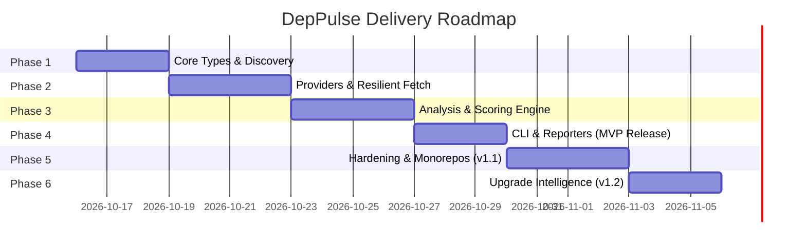

# DepPulse Engineering Phased Plan

## Executive Summary & Non-Negotiable Boundaries

- **Product**: DepPulse (`deppulse`) – Developer tooling CLI and TypeScript engine for third-party dependency health, maintenance risk assessment, and upgrade intelligence.
- **Strict Isolation**: Must remain completely separate from MEJOR (`arnav-audit`).
- **Forbidden Features**: No source code scanning, AST inspection, secret detection, or vulnerability scanning. Advisory data is purely contextual and NEVER mixed into the maintenance score.
- **Deferred**: Web dashboards, cloud backends, and AI/LLM integrations are explicitly out of scope for v1.

---

## Roadmap Overview

---

## Phase 1: Core Domain, Schemas & Manifest/Lockfile Discovery

### Deliverables:

- Pure TypeScript domain models and strict Zod configuration schemas.
- Manifest parser (`package.json` extraction of direct dependencies: prod, dev, peer, optional).
- Lockfile v2/v3 decoder (`package-lock.json` parsing with full transitive tree resolution).
- Graceful partial-coverage handling for unsupported lockfile versions.

### Files:

- `src/core/types.ts`
- `src/policy/schemas.ts`
- `src/discovery/manifest.ts`
- `src/discovery/lockfiles/npm-v2-v3.ts`
- `src/discovery/lockfiles/types.ts`
- `src/discovery/lockfiles/resolver.ts`
- `test/unit/discovery/manifest.test.ts`
- `test/unit/discovery/lockfile.test.ts`
- `test/fixtures/projects/basic-npm/...`
- `test/fixtures/projects/lockfile-v1-unsupported/...`

### Tests & Acceptance Criteria:

- **Unit**: Verify `package.json` correctly categorizes prod, dev, peer, and optional deps.
- **Unit**: Verify `package-lock.json` v2/v3 correctly builds graph of direct and transitive dependencies.
- **Acceptance Criterion**: When an unsupported lockfile (v1 or yarn/pnpm) is encountered, the discovery engine emits a structured warning and returns direct dependencies with `transitiveCoverage: 'partial'`, never crashing.

---

## Phase 2: Providers, Resilient Networking & Cache Layer

### Deliverables:

- In-memory & local disk cache (`.deppulse/cache/`) with TTL hierarchy and atomic file operations.
- Resilient HTTP client with SSRF protection, protocol whitelist, timeout control via `AbortSignal`, and exponential backoff with full jitter.
- npm Registry Provider: Packument fetching, version time extraction, deprecation message retrieval.
- GitHub Provider: GraphQL/REST repository metadata (archive status, last commit, open issues).
- Repo Identity Verifier: Validates that claimed repo actually hosts or publishes the package (anti-spoofing).
- Contextual Advisory Provider: Pulls vulnerability advisories as isolated annotations (0 score contribution).

### Files:

- `src/cache/disk-store.ts`
- `src/cache/types.ts`
- `src/providers/http/client.ts`
- `src/providers/http/ssrf-guard.ts`
- `src/providers/npm/registry.ts`
- `src/providers/github/client.ts`
- `src/providers/advisory/osv.ts`
- `src/analysis/repo-verifier.ts`
- `test/unit/providers/http-resilience.test.ts`
- `test/unit/providers/repo-verifier.test.ts`
- `test/unit/cache/disk-store.test.ts`

### Tests & Acceptance Criteria:

- **Resilience**: Simulated HTTP 429 returns with `Retry-After` retry logic and does not exceed bounded concurrency.
- **Security**: Target URLs to `http://` or private internal IPs (`127.0.0.1`, `169.254.169.254`) are blocked with `SSRFProtectionError`.
- **Anti-Spoofing**: A fake package claiming `https://github.com/facebook/react` is flagged as `associationStatus: 'divergent'`.

---

## Phase 3: Analysis & Scoring Engine (Pure Math & Rules)

### Deliverables:

- Telemetry aggregator and evidence compiler.
- Maturity curve calibrator (detects stable, single-purpose libraries vs abandoned packages).
- Pure deterministic scoring engine with versioned rule sets.
- Confidence score calculator (missing data reduces confidence, never deducts health points).
- Calibration test suite with 12 golden package fixtures.

### Files:

- `src/analysis/cadence.ts`
- `src/analysis/compatibility.ts`
- `src/scoring/engine.ts`
- `src/scoring/confidence.ts`
- `src/scoring/maturity.ts`
- `src/scoring/rules/v1.ts`
- `test/unit/scoring/scoring-engine.test.ts`
- `test/unit/scoring/maturity.test.ts`
- `test/integration/calibration-fixtures.test.ts`

### Tests & Acceptance Criteria:

- **Golden Fixture Verification**:
  - `wrappy` and `mime-types` achieve $\ge 80$ score (Low Risk) despite multi-year release gaps.
  - `request` is capped at $\le 20$ (Critical Risk) due to deprecation.
  - Unverified repo spoof achieves $\le 35$ (High Risk).
  - Package with sparse telemetry returns `score: null` and `maintenanceRisk: 'unknown'`.
- **Zero Double-Counting**: Simultaneous negative signals apply fatal caps rather than negative accumulation below 0.

---

## Phase 4: CLI, Reporters, Policy Engine & MVP Completion

### Deliverables:

- CLI command dispatcher with Commander:
  - `deppulse scan [path]`
  - `deppulse analyze <pkg>`
  - `deppulse explain <pkg>`
- Reporters: ANSI colored terminal table/card format, structured JSON, and Markdown format.
- Policy evaluator: checks results against `failOnRisk`, `maxHighRiskAllowed`, and `allowList`.
- Exit codes: 0 (clean), 1 (policy violation), 2 (runtime error).

### Files:

- `src/cli/index.ts`
- `src/cli/commands/scan.ts`
- `src/cli/commands/analyze.ts`
- `src/cli/commands/explain.ts`
- `src/cli/formatters/terminal.ts`
- `src/cli/formatters/json.ts`
- `src/cli/formatters/markdown.ts`
- `src/policy/evaluator.ts`
- `test/e2e/cli-scan.test.ts`
- `test/e2e/cli-exit-codes.test.ts`

### Tests & Acceptance Criteria:

- **E2E**: `deppulse scan --format json` outputs valid schema-compliant JSON to stdout.
- **Exit Code**: Scanning a fixture with deprecated dependency and `--fail-on critical` exits with code 1.
- **Exit Code**: Scanning with an invalid flag exits with code 2 and a recovery hint.

---

## Phase 5: Hardening & v1.1 Enhancements

### Scope (v1.1):

- Lockfile support for `pnpm` (`pnpm-lock.yaml`) and `yarn` (`yarn.lock` v1 & berry).
- Monorepo & workspace awareness (filtering internal workspace packages from external npm packages).
- Markdown PR comment summary formatter optimized for GitHub Actions.
- Performance optimization: caching in CI environments.

---

## Phase 6: Upgrade Intelligence & v1.2 Scope

### Scope (v1.2):

- `deppulse compare <pkg> --from <v1> --to <v2>` command.
- Breaking change and engine deprecation diffing between versions.
- Step-by-step upgrade path recommendations (safe jump targets avoiding known unmaintained intermediate releases).

---

## Minimum File Set for First Working Vertical Slice (MVP Slice)

To produce the first end-to-end working execution (`deppulse scan` on an npm project outputting a terminal health table):

1. `package.json` (scaffold, dependencies: `commander`, `zod`, `picocolors`)
2. `tsconfig.json` (strict NodeNext configuration)
3. `tsup.config.ts` (ESM build config)
4. `src/index.ts` (Root library export)
5. `src/cli/index.ts` (CLI bin entry)
6. `src/cli/commands/scan.ts` (Scan orchestrator)
7. `src/cli/formatters/terminal.ts` (ANSI table formatter)
8. `src/core/types.ts` (Domain definitions)
9. `src/core/engine.ts` (Workflow runner)
10. `src/discovery/manifest.ts` (package.json reader)
11. `src/discovery/lockfiles/npm-v2-v3.ts` (npm lockfile parser)
12. `src/providers/http/client.ts` (Fetch wrapper with timeout & basic retry)
13. `src/providers/npm/registry.ts` (packument fetcher)
14. `src/analysis/cadence.ts` (Recency & cadence calculator)
15. `src/scoring/engine.ts` (Deterministic score calculator v1)
16. `src/scoring/maturity.ts` (Mature-stable evaluator)
17. `src/cache/disk-store.ts` (Local disk cache)
18. `src/policy/evaluator.ts` (Policy and exit code checker)
