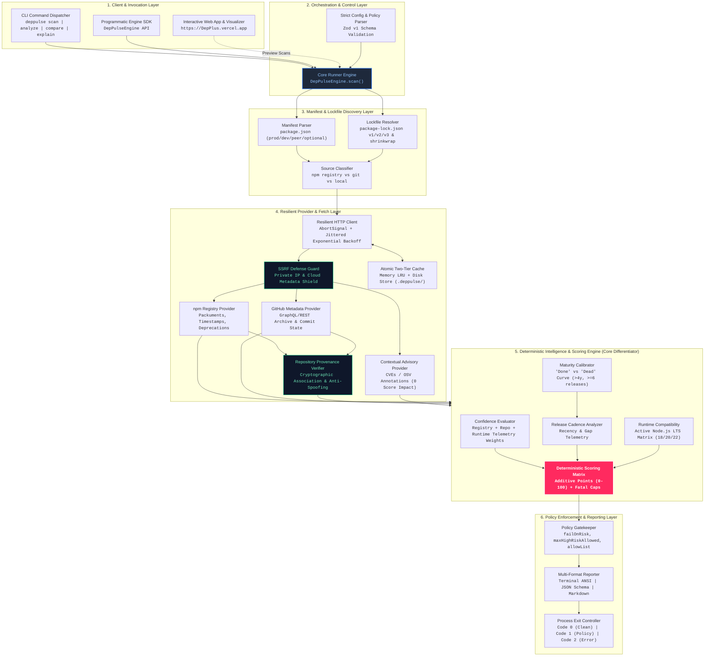
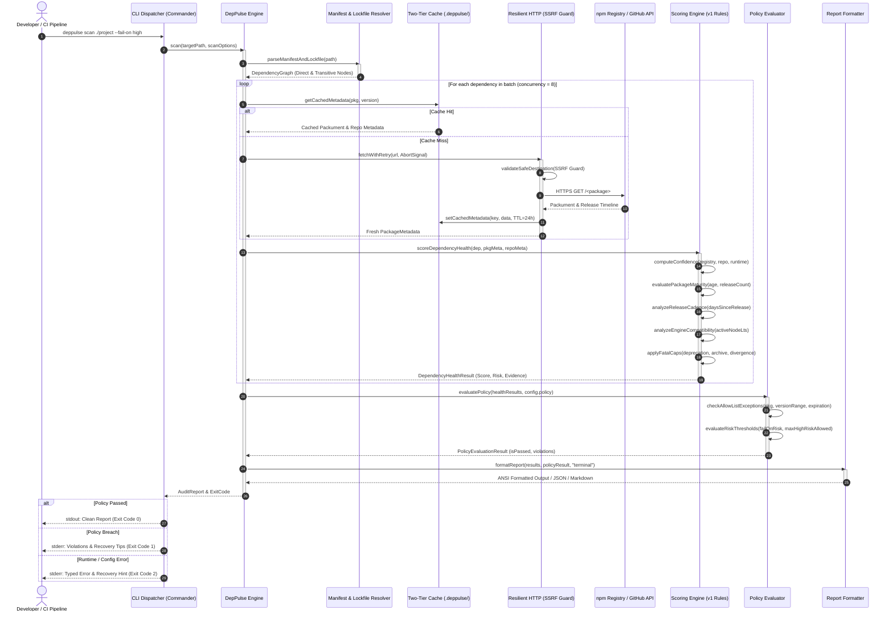
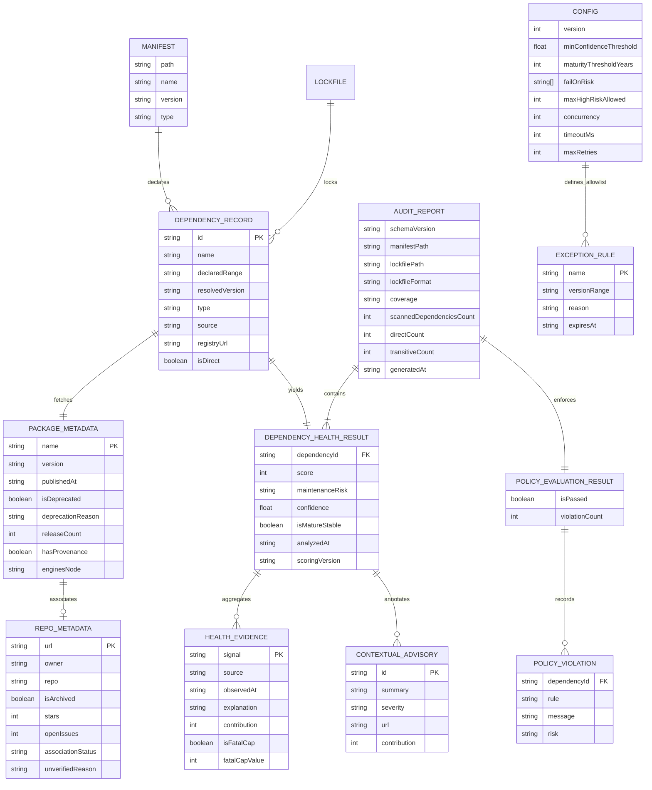
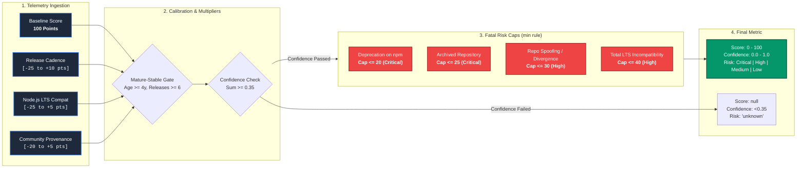

# DepPulse

> **Deterministic dependency maintenance health and upgrade risk intelligence for Node.js.**  
> Know which third-party packages are actively maintained, abandoned, or quietly archived—backed by verifiable telemetry, calibrated mature-package awareness, and zero speculative guesswork.

[](https://github.com/arnnnnaaavvvvv/DepPlus/actions)
[](https://www.npmjs.com/package/@arnavvv/deppulse)
[](https://nodejs.org)
[](https://www.typescriptlang.org)
[](https://DepPlus.vercel.app)
[](LICENSE)

---

## Overview

**DepPulse** is a production-grade developer tool and decoupled TypeScript analysis engine that audits the maintenance health and upgrade risks of third-party Node.js dependencies across direct and transitive trees. Built for platform engineers, security teams, and engineering leads who cannot afford to let abandoned, archived, or runtime-incompatible packages accumulate silently in mission-critical applications, DepPulse replaces subjective metrics and noisy alert firehoses with a deterministic, calibrated 0–100 scoring model. Unlike standard vulnerability scanners or semver checkers, DepPulse evaluates real-world upstream maintenance signals—including release timelines, active Node.js LTS compatibility, and cryptographic repository provenance—while explicitly protecting "done" mature utilities from naive inactivity penalties.

---

## Feature Matrix

| Feature                                        | Description                                                                                                                                                                         |
| :--------------------------------------------- | :---------------------------------------------------------------------------------------------------------------------------------------------------------------------------------- |
| **Deterministic 0–100 Health Scoring**         | Computes a transparent, reproducible health score based on published telemetry and versioned mathematical rules without black-box ML or subjective ratings.                         |
| **"Done" vs. "Dead" Maturity Calibration**     | Distinguishes feature-complete, rock-solid utilities (e.g., `wrappy`, `mime-types`) from abandoned codebases by calibrating age ($\ge 4$ years) against lifetime release stability. |
| **Non-Linear Fatal Score Caps**                | Halts score accumulation upon detecting irreversible risk signals (deprecation caps at $\le 20$, archived GitHub repos cap at $\le 25$, divergent provenance caps at $\le 30$).     |
| **Node.js LTS Compatibility Matrix**           | Assesses package `engines.node` declarations against active LTS release lines (Node.js 18, 20, 22), flagging packages incompatible with current production environments.            |
| **Cryptographic Provenance & Anti-Spoofing**   | Cross-validates claimed repository coordinates against npm registry metadata and sigstore build provenance to detect spoofed monorepo URLs.                                         |
| **Decoupled Advisory Isolation**               | Ingests CVE and advisory data purely as contextual awareness annotations; security alerts contribute exactly **0 points** to maintenance score calculation.                         |
| **Full Transitive Lockfile Resolution**        | Parses `package-lock.json` (v1, v2, v3) and `npm-shrinkwrap.json` to uncover deeply nested maintenance debt down through transitive layers.                                         |
| **Resilient Network & SSRF Defense**           | Features jittered exponential backoff, rate-limit adaptation, protocol allowlists, and loopback/cloud-metadata blocking (`169.254.169.254`, `127.0.0.1`).                           |
| **Strict Read-Only Verification**              | Guarantees zero disk writes to target project manifests, zero lockfile mutations, and zero execution of arbitrary lifecycle scripts (`postinstall`).                                |
| **CI Policy Gatekeeper & Exit Code Mapping**   | Enforces customizable quality gates (`failOnRisk`, `maxHighRiskAllowed`, time-bounded `allowList` exceptions) with standard Unix exit codes (0, 1, 2).                              |
| **Interactive Terminal Simulator & Web Suite** | Deployed at [DepPlus.vercel.app](https://DepPlus.vercel.app) with an interactive CLI simulator, dynamic scoring playground, and visual config builder.                              |

---

## What It Can Do Now

- **Audit full dependency trees**: Scans `package.json` manifests alongside `package-lock.json` v1/v2/v3 and `npm-shrinkwrap.json`, mapping direct and transitive packages.
- **Surface fatal maintenance signals**: Instantly pinpoints deprecated packages, archived upstream repositories, and runtime-incompatible engine declarations.
- **Prevent naive false alarms**: Recognizes mature single-purpose packages that have not required patches for years, scoring them high if their runtime compatibility remains intact.
- **Verify repository provenance**: Detects package spoofing attempts where an unknown package points its repository field to high-profile repositories like `facebook/react`.
- **Enforce CI build policies**: Fails build pipelines with standard exit codes when dependencies cross configured risk thresholds (`critical`, `high`, `medium`, `unknown`).
- **Support time-bounded exceptions**: Allows development teams to temporarily whitelist risky dependencies with mandatory justifications and ISO-8601 expiration dates.
- **Operate fully offline from cache**: Caches packuments and GitHub metadata in `.deppulse/cache/` with an atomic two-tier cache (memory LRU + local disk store).
- **Export structured audit artifacts**: Generates ANSI terminal tables, schema-compliant JSON reports, or GitHub Flavored Markdown summaries for pull requests.

---

## The Problem: How DepPulse Compares

Most dependency tools answer only two questions: _"Is there a higher version number?"_ (`npm outdated`) or _"Is there a published CVE?"_ (`npm audit`). They leave engineering teams blind to the silent killer of enterprise software: **maintenance obsolescence**.

| Capability / Dimension          | `npm outdated`                 | `Socket.dev`                           | `Renovate` / `Dependabot`         | **DepPulse**                                      |
| :------------------------------ | :----------------------------- | :------------------------------------- | :-------------------------------- | :------------------------------------------------ |
| **Primary Focus**               | Semver numerical deltas        | Supply-chain malware & install scripts | Automated pull-request generation | **Maintenance vitality & upgrade safety**         |
| **Health Scoring**              | None (version diff only)       | Heuristic SaaS alerts                  | None (build pass/fail)            | **Deterministic, calibrated 0–100 score**         |
| **"Done" vs. "Dead" Awareness** | None                           | Flags inactivity as risky              | None                              | **Calibrated mature-stable curve ($\ge 4$ yrs)**  |
| **Repository Verification**     | Blindly displays manifest URLs | Internal closed telemetry              | Trusts git repository strings     | **Cryptographic provenance verification**         |
| **Advisory Handling**           | N/A                            | Blended into risk score                | Direct PR trigger                 | **Decoupled: CVEs carry strictly 0 score impact** |
| **Filesystem Safety**           | Read-only                      | Read-only / Network proxy              | Mutates lockfiles & branches      | **Strictly read-only; zero mutation guarantee**   |
| **Transparency & Math**         | Pure semver comparison         | Proprietary SaaS engine                | Configurable bot rules            | **100% open, versioned, reproducible math**       |
| **Cost & Portability**          | Native / Free                  | Commercial SaaS tier                   | Free / Commercial hosting         | **Open source, zero external cloud dependency**   |

---

## Getting Started

### Prerequisites

- **Node.js**: `v18.0.0` or higher (tested on Node.js 18 LTS, 20 LTS, and 22 LTS)
- **Package Manager**: `npm` (v7+), `pnpm`, or `yarn`

### Installation

Run instantly without installation using `npx`:

```bash
npx @arnavvv/deppulse scan .
```

Or install globally as an engineering CLI:

```bash
npm install -g @arnavvv/deppulse
```

Or add as a development dependency within your project:

```bash
npm install --save-dev @arnavvv/deppulse
```

---

## Example Input → Output

Running `deppulse scan .` on a repository with outdated, deprecated, and mature dependencies generates the following authentic output:

```text
DepPulse v0.1.1 – Dependency Health & Maintenance Intelligence
──────────────────────────────────────────────────────────────────────
Manifest: package.json (npm-v3, coverage: full)
Scanned: 228 dependencies (14 direct, 214 transitive, 0 skipped)

Health Overview: Critical: 1 | High: 1 | Medium: 7 | Low (Healthy): 219
Average Health Score: 97/100
──────────────────────────────────────────────────────────────────────

Actionable Maintenance Alerts:

   CRITICAL   eslint@9.39.5 [direct] Score: 20
     ✖ Package is deprecated: This version is no longer supported. Please see https://eslint.org/version-support for other options.

   HIGH       @napi-rs/lzma-linux-x64-gnu@1.5.1 [transitive] Score: 40
     ✖ Declared engines.node '^22.20 || ^24.12 || >=25' is incompatible with all current Node.js LTS runtimes.

   MEDIUM     concat-map@0.0.1 [transitive] Score: 75
     ⚠ Stagnant release cadence: no published releases in 4641 days (>2 years). (-25)

   MEDIUM     deep-is@0.1.4 [transitive] Score: 75
     ⚠ Stagnant release cadence: no published releases in 1866 days (>2 years). (-25)

──────────────────────────────────────────────────────────────────────
✖ POLICY FAILED: Found 2 policy violation(s):
   - Dependency eslint@9.39.5 carries critical maintenance risk (score: 20). (Rule: failOnRisk contains 'critical')
   - Project contains 1 high risk dependencies, exceeding allowed limit of 0. (Rule: maxHighRiskAllowed (0))

Tip: Review flagged dependencies in the report or add an exception with justification in deppulse.config.json
```

---

## Usage Examples

### 1. Project Scan (`scan`)

Scans your project's manifests and lockfiles, resolves dependency trees, calculates health scores, and applies CI policies:

```bash
# Scan current directory using default terminal output
deppulse scan

# Scan only direct dependencies (bypasses transitive lockfile parsing)
deppulse scan --direct

# Scan a specific directory and output machine-readable JSON
deppulse scan ./packages/api --format json --output audit-report.json

# Enforce strict policy: fail build on any 'high' or 'critical' risk
deppulse scan --fail-on high --verbose
```

### 2. Single Package Analysis (`analyze`)

Fetches package packuments, inspects release frequencies, evaluates repository health, and outputs a single-package scorecard:

```bash
# Analyze latest release
deppulse analyze express

# Analyze a specific pinned version
deppulse analyze rimraf@3.0.2

# Get raw telemetry and score breakdown as JSON
deppulse analyze lodash --format json
```

### 3. Upgrade Risk Comparison (`compare`)

Compares two versions of a dependency to evaluate breaking changes, runtime engine shifts, and maintenance trajectory:

```bash
# Check upgrade feasibility from rimraf v3 to v5
deppulse compare rimraf --from 3.0.2 --to 5.0.5

# Check if target version resolves deprecation or introduces incompatibilities
deppulse compare eslint --from 8.57.0 --to 9.14.0
```

### 4. Mathematical Audit Trail (`explain`)

Prints the exact chain of evidence, mathematical weights, and applied fatal caps that produced a package's score:

```bash
deppulse explain request
deppulse explain wrappy
```

### 5. Programmatic TypeScript Engine SDK

The core engine is completely decoupled from the CLI and can be embedded directly into custom tooling or internal developer portals:

```typescript
import { DepPulseEngine, getDefaultConfig } from '@arnavvv/deppulse';

// Initialize engine with strict default configuration
const engine = new DepPulseEngine(getDefaultConfig());

// 1. Scan a project repository
const report = await engine.scan('./my-service');
console.log(`Scanned: ${report.scannedDependenciesCount} packages`);
console.log(`Average Health Score: ${report.summary.averageScore}/100`);
console.log(`Policy Status: ${report.policyResult.isPassed ? 'PASSED' : 'FAILED'}`);

// 2. Perform targeted single-package evaluation
const result = await engine.analyze('wrappy', '0.0.2');
console.log(`Score: ${result.score}, Mature-Stable: ${result.isMatureStable}`);
```

---

## Configuration Reference

DepPulse supports project-level configuration via `deppulse.config.json` (or `.deppulserc.json`). Every configuration schema is strictly validated at runtime using Zod.

```json
{
  "$schema": "https://deppulse.dev/schemas/config-v1.json",
  "version": 1,
  "scoring": {
    "minConfidenceThreshold": 0.35,
    "maturityThresholdYears": 4
  },
  "policy": {
    "failOnRisk": ["critical", "high"],
    "maxHighRiskAllowed": 0,
    "treatUnknownAsFailure": false,
    "allowList": [
      {
        "name": "legacy-auth-helper",
        "versionRange": "^1.2.0",
        "reason": "Internal migration to OAuth scheduled for Q4 2026",
        "expiresAt": "2026-12-31T23:59:59Z"
      }
    ]
  },
  "network": {
    "concurrency": 8,
    "timeoutMs": 8000,
    "maxRetries": 3,
    "allowedRegistries": ["https://registry.npmjs.org"]
  },
  "cache": {
    "enabled": true,
    "dir": ".deppulse/cache",
    "ttlHours": 24
  }
}
```

### Configuration Options & Flags

| Option / Flag                    | Type                  | Default        | Description                                                                                                                 |
| :------------------------------- | :-------------------- | :------------- | :-------------------------------------------------------------------------------------------------------------------------- |
| `version`                        | `number`              | `1`            | Schema version identifier (strictly versioned).                                                                             |
| `scoring.minConfidenceThreshold` | `float` (0.0–1.0)     | `0.35`         | Minimum data completeness required before assigning a numerical score; scores below this return `null` with `unknown` risk. |
| `scoring.maturityThresholdYears` | `number`              | `4`            | Number of years since initial release required for a package to qualify for mature-stable classification.                   |
| `policy.failOnRisk`              | `enum[]`              | `["critical"]` | Risk levels that trigger a policy failure (exit code 1). Values: `low`, `medium`, `high`, `critical`, `unknown`.            |
| `policy.maxHighRiskAllowed`      | `number`              | `0`            | Upper limit of high-risk dependencies tolerated before build fails.                                                         |
| `policy.allowList`               | `ExceptionRule[]`     | `[]`           | Temporary exceptions bypass policy failures when verified by documented rationale and unexpired timestamp.                  |
| `network.concurrency`            | `number` (1–32)       | `8`            | Maximum concurrent upstream HTTP requests dispatched during scanning.                                                       |
| `network.timeoutMs`              | `number` (1000–30000) | `8000`         | HTTP request timeout in milliseconds using `AbortSignal`.                                                                   |
| `network.maxRetries`             | `number` (0–5)        | `3`            | Exponential backoff retry attempts for 429 and transient 5xx responses.                                                     |
| `cache.enabled`                  | `boolean`             | `true`         | Enables local two-tier response caching.                                                                                    |
| `cache.ttlHours`                 | `number`              | `24`           | Cache lifespan in hours for registry and repository metadata.                                                               |
| `GITHUB_TOKEN` _(env)_           | `string`              | `undefined`    | Optional GitHub personal access token to prevent API rate-limiting on upstream repo checks.                                 |

---

## System Architecture

_High-level multi-tiered architecture diagram showing request progression from client interfaces through discovery, networking resilience, deterministic scoring intelligence, and policy enforcement._



---

## Core Workflow Sequence

_End-to-end execution sequence illustrating parallel dependency discovery, metadata retrieval with backoff and cache checking, deterministic scoring with fatal caps, and CI policy gating._



---

## Scoring & Policy Decision Flow

_Logic flowchart demonstrating the deterministic evaluation pipeline: from data completeness gates through additive scoring, fatal cap triggers, risk tier classification, and CI exception bypasses._

```mermaid
flowchart TD
    Start(["Start Package Evaluation"]) --> Ingest["Ingest Package & Repo Metadata"]

    Ingest --> CheckConf{"Confidence >= 0.35?<br/>(Registry + Repo + Runtime)"}

    CheckConf -- "No (Telemetry Sparse)" --> MarkUnknown["Score: null<br/>Risk: 'unknown'<br/>Add Telemetry Evidence"]
    CheckConf -- "Yes (Sufficient Data)" --> BaseScore["Initialize Raw Score = 100"]

    BaseScore --> CheckMaturity{"Age >= 4 Years AND<br/>Releases >= 6 AND<br/>Not Deprecated?"}
    CheckMaturity -- "Yes" --> MatureMode["Apply Mature-Stable Lifecycle<br/>Waive Naive Recency Penalties"]
    CheckMaturity -- "No" --> ActiveMode["Apply Active Lifecycle<br/>Standard Cadence Expectations"]

    MatureMode --> CadenceEval["Evaluate Release Cadence"]
    ActiveMode --> CadenceEval

    CadenceEval --> NodeCompat{"engines.node Compatible<br/>with Active Node LTS (18, 20, 22)?"}
    NodeCompat -- "Full Coverage" --> AddNodeBonus["Add Engine Compatibility (+5)"]
    NodeCompat -- "Partial Coverage" --> NeutralNode["Neutral Engine Impact (0)"]
    NodeCompat -- "Zero Coverage" --> IncompatPenalty["Incompatible Engine (-25)<br/>Flag Fatal Cap = 40"]

    AddNodeBonus --> CheckRepo["Check Upstream GitHub Metadata"]
    NeutralNode --> CheckRepo
    IncompatPenalty --> CheckRepo

    CheckRepo --> RepoStatus{"Repository Association<br/>& State?"}
    RepoStatus -- "Verified & Active" --> RepoBonus["Community Trust Bonus (+5)"]
    RepoStatus -- "Divergent / Spoofed" --> SpoofCap["Divergent Provenance (-20)<br/>Flag Fatal Cap = 30"]
    RepoStatus -- "Archived by Owner" --> ArchiveCap["Archived Repository (-75)<br/>Flag Fatal Cap = 25"]

    RepoBonus --> CheckDeprec{"Is Package Deprecated<br/>on npm Registry?"}
    SpoofCap --> CheckDeprec
    ArchiveCap --> CheckDeprec

    CheckDeprec -- "Yes" --> DeprecCap["Deprecation Confirmed (-80)<br/>Flag Fatal Cap = 20"]
    CheckDeprec -- "No" --> SumScore["Sum Additive Evidence"]
    DeprecCap --> SumScore

    SumScore --> ApplyCaps{"Any Fatal Caps<br/>Triggered?"}
    ApplyCaps -- "Yes" --> CapMath["Score = min(RawScore, LowestFatalCap)"]
    ApplyCaps -- "No" --> ClampMath["Score = clamp(RawScore, 0, 100)"]
    CapMath --> ClampMath

    ClampMath --> TierScore{"Classify Risk Tier"}
    TierScore -- "Score <= 25" --> CriticalRisk["Risk: CRITICAL"]
    TierScore -- "Score 26 - 49" --> HighRisk["Risk: HIGH"]
    TierScore -- "Score 50 - 79" --> MediumRisk["Risk: MEDIUM"]
    TierScore -- "Score 80 - 100" --> LowRisk["Risk: LOW (Healthy)"]

    CriticalRisk --> CheckPolicy["Evaluate Policy Rules"]
    HighRisk --> CheckPolicy
    MediumRisk --> CheckPolicy
    LowRisk --> CheckPolicy
    MarkUnknown --> CheckPolicy

    CheckPolicy --> CheckAllowList{"Matches unexpired<br/>allowList Exception?"}
    CheckAllowList -- "Yes" --> AllowBypass["Allow with Documented Reason<br/>Zero CI Failure"]
    CheckAllowList -- "No" --> CheckBreach{"Risk matches failOnRisk OR<br/>High Risk > maxHighRiskAllowed?"}

    CheckBreach -- "Yes" --> PolicyFail(["Exit Code 1: Policy Violation"])
    CheckBreach -- "No" --> PolicyPass(["Exit Code 0: Policy Passed"])
    AllowBypass --> PolicyPass

    classDef capNode fill:#ef4444,stroke:#991b1b,stroke-width:2px,color:#ffffff;
    classDef bonusNode fill:#10b981,stroke:#065f46,stroke-width:1.5px,color:#ffffff;
    classDef passNode fill:#059669,stroke:#064e3b,stroke-width:2px,color:#ffffff;
    classDef failNode fill:#dc2626,stroke:#7f1d1d,stroke-width:2px,color:#ffffff;
    classDef diamond fill:#1e293b,stroke:#64748b,stroke-width:1.5px,color:#e2e8f0;

    class DeprecCap,ArchiveCap,SpoofCap,IncompatPenalty capNode;
    class AddNodeBonus,RepoBonus,MatureMode bonusNode;
    class PolicyPass passNode;
    class PolicyFail failNode;
    class CheckConf,CheckMaturity,NodeCompat,RepoStatus,CheckDeprec,ApplyCaps,TierScore,CheckAllowList,CheckBreach diamond;
```



---

## Entity Relationship Model

_Data model relationship diagram capturing domain entities across discovery manifests, upstream metadata, health scoring evidence, contextual advisories, and policy audit reports._



---

## Core Algorithm & Scoring Logic

DepPulse rejects opaque heuristic guesswork. The scoring engine evaluates packages using pure mathematics and versioned rules based on five clear principles:

### 1. Confidence Floor Gating

Before any score is assigned, DepPulse verifies telemetry completeness:

$$\text{Confidence} = C_{\text{registry}} (0.40) + C_{\text{repo}} (0.35) + C_{\text{runtime}} (0.15) + C_{\text{provenance}} (0.10)$$

If $\text{Confidence} < \text{minConfidenceThreshold}$ ($0.35$), no speculative score is produced:
$$\text{Score} = \text{null}, \quad \text{Risk} = \text{'unknown'}$$
_Missing data is never penalized as poor health._

### 2. Mature-Stable Lifecycle Calibration

A package qualifies as **mature-stable** if:

1. First published release was $\ge 4$ years ago ($\text{ageYears} \ge 4$).
2. Has accumulated $\ge 6$ lifetime releases.
3. Is not deprecated on the npm registry.

For mature-stable packages, naive release gap penalties are waived. A package last released 3 years ago incurs **0 penalty** as long as it satisfies modern Node LTS runtimes.

### 3. Additive Summation and Fatal Score Caps

The system initializes with a baseline of **100 points**, sums all observed positive and negative evidence contributions, and then applies **Fatal Caps** using non-linear bounding:

$$\text{RawScore} = 100 + \sum_{i} \text{contribution}_i$$
$$\text{FinalScore} = \min\left(\text{RawScore}, \min_{j \in \text{FatalCaps}} (\text{capValue}_j)\right)$$

| Signal                  | Condition                                                 | Penalty / Cap                  | Risk Tier        |
| :---------------------- | :-------------------------------------------------------- | :----------------------------- | :--------------- |
| **Deprecation**         | Marked deprecated in registry metadata                    | $\text{Cap} \le 20$            | **Critical**     |
| **Archived Repo**       | Upstream GitHub repo archived by owner                    | $\text{Cap} \le 25$            | **Critical**     |
| **Repo Spoofing**       | Claimed repository diverges from package identity         | $\text{Cap} \le 30$            | **High**         |
| **Engine Incompatible** | Does not satisfy any active Node.js LTS (18, 20, 22)      | $-25$ pts, $\text{Cap} \le 40$ | **High**         |
| **Stagnant Cadence**    | $> 730$ days without release (Active tier)                | $-25$ pts                      | **Medium**       |
| **Community Trust**     | Verified repo with active community ($> 100$ stars)       | $+5$ pts                       | **Low**          |
| **Full LTS Support**    | Declared `engines.node` satisfies all active LTS runtimes | $+5$ pts                       | **Low**          |
| **Security Advisory**   | Vulnerabilities present in advisory database              | **Strictly 0 pts**             | _(Context Only)_ |

_Convergence flow of independent deterministic inputs, mature-stable gating, and non-linear fatal caps producing an unspeculative maintenance score._



---

## Error Handling & Exit Codes

DepPulse provides deterministic, typed errors separating policy failures from operational runtime faults:

| Exit Code | Error Category            | Class Name               | Description                                                                                    | Recovery Hint                                                                                   |
| :-------: | :------------------------ | :----------------------- | :--------------------------------------------------------------------------------------------- | :---------------------------------------------------------------------------------------------- |
|  **`0`**  | `SUCCESS`                 | —                        | All dependencies analyzed cleanly; no configured policy violations detected.                   | Normal pipeline execution.                                                                      |
|  **`1`**  | `POLICY_VIOLATION`        | `PolicyViolationError`   | One or more dependencies breached policy thresholds (`failOnRisk`, `maxHighRiskAllowed`).      | Review flagged packages, upgrade to maintained releases, or add documented allowlist exception. |
|  **`2`**  | `CONFIG_VALIDATION_ERROR` | `ConfigValidationError`  | Configuration file failed Zod schema validation (e.g. invalid type or unsupported version).    | Validate syntax against `ConfigSchema` in `deppulse.config.json`.                               |
|  **`2`**  | `DISCOVERY_ERROR`         | `DiscoveryError`         | Target directory is missing `package.json` or manifest cannot be read.                         | Ensure valid project path is provided and file permissions allow read access.                   |
|  **`2`**  | `LOCKFILE_PARSE_ERROR`    | `LockfileParseError`     | Lockfile is corrupt, incomplete, or formatted unexpectedly.                                    | Regenerate lockfile via `npm install --package-lock-only`.                                      |
|  **`2`**  | `SSRF_PROTECTION_ERROR`   | `SSRFProtectionError`    | Target outbound URL resolves to loopback (`127.0.0.1`), private RFC1918 IP, or cloud metadata. | Ensure registry URLs in config point to verified public HTTPS endpoints.                        |
|  **`2`**  | `RATE_LIMIT_EXCEEDED`     | `RateLimitExceededError` | Upstream registry or GitHub API rate limits exhausted.                                         | Provide `GITHUB_TOKEN` in environment or increase backoff limits.                               |
|  **`2`**  | `USAGE_ERROR`             | `UsageError`             | Invalid CLI arguments, unrecognized flags, or missing required version params.                 | Run `deppulse --help` to inspect command syntax.                                                |

---

## Testing & Quality Assurance

DepPulse includes an exhaustive automated test suite covering unit math, HTTP resilience, security guards, golden calibration packages, and strict filesystem immutability:

```bash
# Run complete test suite (Vitest)
npm test

# Run tests in watch mode during development
npm run test:watch

# Generate coverage report
npm run test:coverage

# Perform static type checking across the entire project
npm run typecheck

# Verify ESLint rules
npm run lint

# Verify Prettier code formatting
npm run format
```

### Verification Highlights

- **Filesystem Diff Verification (`test/integration/filesystem-diff.test.ts`)**: Generates an SHA-256 fingerprint of the target directory before and after scanning to prove byte-for-byte read-only execution.
- **Golden Package Calibration (`test/unit/scoring/calibration-suite.test.ts`)**: Evaluates 12 reference packages (e.g. `wrappy`, `mime-types`, `request`, `left-pad`) against expected score bounds to ensure stability across releases.
- **SSRF Defense Suite (`test/unit/providers/ssrf-guard.test.ts`)**: Verifies blocking of AWS metadata (`169.254.169.254`), GCP metadata, localhost, and non-HTTPS protocols.

---

## Design Philosophy

1. **Deterministic & Explainable**: Given identical upstream metadata, DepPulse produces the exact same score every single run. Every deduction carries an attached evidence record with human-readable rationale.
2. **Zero Mutation Guarantee**: DepPulse is strictly an auditor. It will never modify lockfiles, never rewrite `package.json`, never install dependencies, and never execute package lifecycle scripts.
3. **Decoupled Security Context**: Vulnerabilities and maintenance health are distinct engineering concerns. CVE advisories are presented for context but never pollute maintenance scores.
4. **Maturity-Calibrated Fairness**: Code that is finished, stable, and functionally complete is an asset, not a liability. Stable utilities are protected from naive release recency penalties.
5. **Zero Double-Counting**: Multiple indicators of an abandoned codebase apply fatal caps rather than accumulating negative numbers below zero.

---

## Roadmap

### Current Release: v0.1.1 (Shipped)

- [x] Full npm lockfile v1, v2, v3 and shrinkwrap deep tree resolution.
- [x] Deterministic scoring engine with mature-stable calibration.
- [x] Repository anti-spoofing and provenance checks.
- [x] Resilient HTTP client with jittered backoff, rate-limit adaptation, and SSRF guard.
- [x] Atomic two-tier caching (`.deppulse/cache/`).
- [x] Terminal ANSI, JSON, and Markdown report formatters.
- [x] Production web visualizer and interactive simulator deployed at [DepPlus.vercel.app](https://DepPlus.vercel.app).

### Phase 5: v1.1 Enhancements (In Progress)

- [ ] Deep AST parsing for `pnpm-lock.yaml` virtual dependency stores.
- [ ] Native parsing for `yarn.lock` (v1 Classic and v2+ Berry).
- [ ] Monorepo workspace matrix awareness (filtering internal packages from npm registries).
- [ ] GitHub Actions native action with automated pull-request summary comments.

### Phase 6: v1.2 Upgrade Intelligence (Planned)

- [ ] Upgrade diffing engine (`deppulse compare`) identifying breaking runtime shifts.
- [ ] Multi-step migration path recommendations avoiding unmaintained intermediate releases.
- [ ] Exportable SBOM health metadata (CycloneDX / SPDX enrichment).

---

## Authors & Contributors

- **Arnav Singh** — _Lead Architect & Author_ — [@arnnnnaaavvvvv](https://github.com/arnnnnaaavvvvv)

Contributions, feature requests, and issue reports are welcome via [GitHub Issues](https://github.com/arnnnnaaavvvvv/DepPlus/issues).

---

## License

This project is licensed under the [MIT License](LICENSE) © 2026 Arnav.
