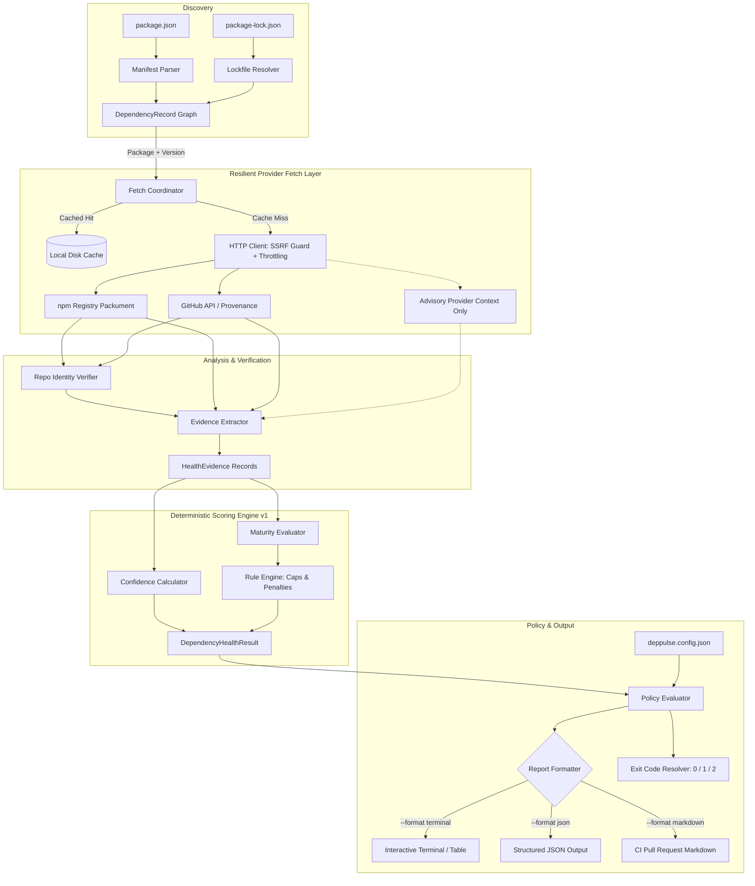

# DepPulse Architecture Specification (v1.0 Draft)

## 1. System Overview & Boundaries

`deppulse` is a developer-tooling CLI and TypeScript engine providing dependency health telemetry and upgrade intelligence for Node.js projects.

### System Boundaries & Non-Goals

- **In Scope**: Third-party package health, maintenance velocity, deprecation risk, repository archive status, Node.js engine compatibility, package maturity calibration, and upgrade path risk assessment.
- **Strictly Out of Scope**:
  - Source-code scanning, AST inspection, secret detection (reserved for MEJOR / `arnav-audit`).
  - Vulnerability scanning / CVE auditing as a score factor (advisories are contextual annotations only, strictly decoupled from the maintenance score).
  - Code generation, automated dependency rewriting, or mutating `package.json`/lockfiles.

---

## 2. Module Layout

```
src/
├── cli/                        # CLI Entrypoint & Commands (Commander / Clack)
│   ├── commands/               # scan, analyze, compare, explain
│   ├── formatters/             # terminal (ANSI/table), json, markdown
│   ├── errors.ts               # CLI error handling & recovery hints
│   └── index.ts                # Binary executable entry point
├── core/                       # Decoupled Engine (consumable as pure TS SDK)
│   ├── engine.ts               # Core orchestrator: runs discovery -> fetch -> analysis -> scoring -> policy
│   ├── types.ts                # Canonical domain models & interfaces
│   └── index.ts                # Public library exports
├── discovery/                  # Manifest & Lockfile Parsers
│   ├── manifest.ts             # package.json parser & workspace discovery
│   ├── lockfiles/              # Lockfile format decoders
│   │   ├── npm-v2-v3.ts        # npm lockfile v2/v3 parser (MVP)
│   │   ├── types.ts            # LockfileAST interface
│   │   └── resolver.ts         # Dependency tree & transitives graph builder
│   └── index.ts
├── providers/                  # Upstream Data Fetchers
│   ├── npm/                    # npm Registry API client (packument, versions, time)
│   ├── github/                 # GitHub REST/GraphQL client (commits, issues, archive flag)
│   ├── advisory/               # Advisory signal client (context-only, unweighted)
│   ├── http/                   # Resilient HTTP client (SSRF guard, retry, jitter, rate limiter)
│   └── types.ts
├── analysis/                   # Raw Fact Aggregation & Derived Metrics
│   ├── repo-verifier.ts        # Package-to-repo identity verification (anti-spoofing)
│   ├── cadence.ts              # Release frequency & commit recency metrics
│   ├── compatibility.ts        # Node engine and peer dependency analyzer
│   └── index.ts
├── scoring/                    # Pure Deterministic Scoring Engine (No ML)
│   ├── engine.ts               # Rules executor & score accumulator
│   ├── confidence.ts           # Telemetry completeness & confidence evaluator
│   ├── maturity.ts             # Maturity curve calibrator (stable vs abandoned)
│   ├── rules/                  # Versioned rule catalog
│   └── index.ts
├── cache/                      # Local File System Cache
│   ├── disk-store.ts           # Safe atomic read/write, TTL validation, compression
│   └── types.ts
├── policy/                     # Rule & Policy Enforcement
│   ├── evaluator.ts            # Evaluates health results against user threshold config
│   └── schemas.ts              # Zod config validation
└── index.ts                    # Root export
```

---

## 3. Mermaid Data-Flow Architecture



---

## 4. Domain Models (TypeScript Types)

```typescript
export type DependencyType = 'prod' | 'dev' | 'optional' | 'peer' | 'transitive';
export type DependencySource = 'npm' | 'workspace' | 'git' | 'file' | 'alias' | 'unknown';
export type MaintenanceRisk = 'low' | 'medium' | 'high' | 'critical' | 'unknown';

export interface DependencyRecord {
  readonly id: string; // e.g. "lodash@4.17.21"
  readonly name: string;
  readonly declaredRange: string;
  readonly resolvedVersion: string;
  readonly type: DependencyType;
  readonly source: DependencySource;
  readonly registryUrl: string;
  readonly isDirect: boolean;
  readonly dependents: readonly string[]; // IDs of packages depending on this
  readonly skipReason?: 'ignored_by_config' | 'private_workspace' | 'unsupported_source';
}

export interface PackageMetadata {
  readonly name: string;
  readonly version: string;
  readonly latestVersion: string;
  readonly description?: string;
  readonly license?: string;
  readonly publishedAt: string; // ISO-8601
  readonly releaseCount: number;
  readonly isDeprecated: boolean;
  readonly deprecationReason?: string;
  readonly engines?: {
    readonly node?: string;
    readonly npm?: string;
  };
  readonly rawRepository?: {
    readonly type?: string;
    readonly url?: string;
    readonly directory?: string;
  };
  readonly hasProvenance: boolean;
  readonly versionsTime: Readonly<Record<string, string>>;
}

export type RepoAssociationStatus = 'verified' | 'unverified' | 'divergent' | 'missing';

export interface RepoMetadata {
  readonly owner: string;
  readonly repo: string;
  readonly associationStatus: RepoAssociationStatus;
  readonly isArchived: boolean;
  readonly isFork: boolean;
  readonly defaultBranch: string;
  readonly stars: number;
  readonly openIssuesCount: number;
  readonly lastCommitAt?: string;
  readonly lastReleaseAt?: string;
  readonly licenseSpdx?: string;
  readonly unverifiedReason?: string;
}

export type EvidenceSignal =
  | 'deprecation'
  | 'archive_status'
  | 'release_recency'
  | 'release_cadence'
  | 'node_engine_compat'
  | 'repo_provenance'
  | 'mature_stability'
  | 'maintenance_commit_recency'
  | 'advisory_context'; // Context only, 0 contribution to score

export interface HealthEvidence {
  readonly signal: EvidenceSignal;
  readonly observedValue: unknown;
  readonly source: 'npm' | 'github' | 'lockfile' | 'manifest' | 'advisory';
  readonly observedAt: string;
  readonly explanation: string;
  readonly contribution: number; // delta on score: -100 to +100
  readonly isFatalCap?: boolean; // When true, caps the maximum possible score
  readonly fatalCapValue?: number;
}

export interface DependencyHealthResult {
  readonly dependency: DependencyRecord;
  readonly score: number | null; // null if confidence < minConfidenceThreshold
  readonly maintenanceRisk: MaintenanceRisk;
  readonly confidence: number; // 0.0 to 1.0
  readonly isMatureStable: boolean;
  readonly evidence: readonly HealthEvidence[];
  readonly contextualAdvisories?: readonly {
    readonly advisoryId: string;
    readonly title: string;
    readonly severity: 'low' | 'moderate' | 'high' | 'critical';
    readonly url: string;
  }[];
  readonly analyzedAt: string;
  readonly scoringVersion: string; // e.g. "1.0.0"
}

export interface UpgradeAssessment {
  readonly dependency: DependencyRecord;
  readonly currentVersion: string;
  readonly targetVersion: string;
  readonly updateType: 'patch' | 'minor' | 'major';
  readonly currentRisk: MaintenanceRisk;
  readonly targetRisk: MaintenanceRisk;
  readonly breakingEngineChanges: boolean;
  readonly recommendation: 'upgrade' | 'monitor' | 'hold' | 'replace';
  readonly rationale: string;
}

export interface PolicyRule {
  readonly failOnRisk: MaintenanceRisk[];
  readonly maxHighRiskCount: number;
  readonly allowList: readonly {
    readonly name: string;
    readonly versionRange?: string;
    readonly reason: string;
    readonly expiresAt?: string; // ISO-8601
  }[];
  readonly minScore?: number;
  readonly treatUnknownAsFailure: boolean;
}

export interface PolicyEvaluationResult {
  readonly isPassed: boolean;
  readonly violations: readonly {
    readonly dependencyId: string;
    readonly rule: string;
    readonly message: string;
    readonly risk: MaintenanceRisk;
  }[];
  readonly allowedExceptions: readonly string[];
}

export interface Report {
  readonly manifestPath: string;
  readonly lockfilePath?: string;
  readonly scannedDependenciesCount: number;
  readonly directCount: number;
  readonly transitiveCount: number;
  readonly summary: {
    readonly lowRisk: number;
    readonly mediumRisk: number;
    readonly highRisk: number;
    readonly criticalRisk: number;
    readonly unknownRisk: number;
    readonly averageScore: number | null;
  };
  readonly results: readonly DependencyHealthResult[];
  readonly upgradeAssessments?: readonly UpgradeAssessment[];
  readonly policyResult: PolicyEvaluationResult;
  readonly generatedAt: string;
}
```

---

## 5. Provider Interfaces, Security & Resilience

```typescript
export interface RequestOptions {
  readonly signal?: AbortSignal;
  readonly timeoutMs?: number;
  readonly forceRefresh?: boolean;
}

export interface NpmRegistryProvider {
  getPackageMeta(packageName: string, options?: RequestOptions): Promise<PackageMetadata>;
}

export interface RepoProvider {
  getRepoMetadata(
    declaredRepoUrl: string,
    expectedPackageName: string,
    options?: RequestOptions,
  ): Promise<RepoMetadata>;
}

export interface AdvisoryProvider {
  getAdvisories(
    packageName: string,
    version: string,
    options?: RequestOptions,
  ): Promise<readonly { id: string; title: string; severity: string; url: string }[]>;
}
```

### Security & Operational Guardrails:

1. **SSRF Guard & Protocol Whitelist**:
   - Only `https:` protocols are accepted.
   - Hostname whitelist: `registry.npmjs.org`, `registry.yarnpkg.com`, `api.github.com`.
   - Private registry hostnames must be explicitly configured in `deppulse.config.json` under `allowedRegistries`. Arbitrary HTTP redirects are strictly blocked.
2. **Response Size Caps**:
   - Maximum packument response size: 10 MB. Packuments exceeding this are aborted via stream sizing to prevent out-of-memory denial-of-service.
3. **Repository Identity Verification (Anti-Spoofing)**:
   - To counter malicious packages pointing their `"repository"` to popular open-source projects, the provider inspects:
     - npm Provenance attestation signature (verified GitHub Actions publishing identity).
     - Package name match against GitHub repository `package.json` or monorepo workspace sub-package name.
     - Release tag matching on GitHub (`v${version}`).
   - If mismatch is detected, `associationStatus` is marked `divergent` or `unverified`, zero GitHub positive reputation is awarded, and a warning evidence signal is emitted.
4. **Resilience & Rate Limiting**:
   - Bounded concurrency: Semaphore set to default 8 concurrent outbound requests.
   - Exponential backoff with Full Jitter: $T = \min(T_{max}, T_{base} \times 2^{attempt}) \pm \text{jitter}$.
   - Respects HTTP `429 Too Many Requests` and `Retry-After` headers.
   - In-memory Promise deduplication prevents redundant simultaneous fetches for the same package.
   - Token Redaction: All Authorization tokens (`NPM_TOKEN`, `GITHUB_TOKEN`, `GH_TOKEN`) are masked before entering logs or error payloads.

---

## 6. Typed Error Model

```typescript
export type ErrorCategory =
  | 'DISCOVERY_ERROR'
  | 'PROVIDER_NETWORK_ERROR'
  | 'RATE_LIMIT_EXCEEDED'
  | 'CORRUPT_LOCKFILE_ERROR'
  | 'CONFIG_VALIDATION_ERROR'
  | 'POLICY_VIOLATION';

export abstract class DepPulseError extends Error {
  abstract readonly category: ErrorCategory;
  abstract readonly exitCode: 0 | 1 | 2;
  readonly timestamp: string = new Date().toISOString();

  constructor(
    message: string,
    public readonly recoveryHint?: string,
  ) {
    super(message);
    Object.setPrototypeOf(this, new.target.prototype);
  }
}

export class DiscoveryError extends DepPulseError {
  readonly category = 'DISCOVERY_ERROR';
  readonly exitCode = 2;
}

export class ProviderNetworkError extends DepPulseError {
  readonly category = 'PROVIDER_NETWORK_ERROR';
  readonly exitCode = 2;
}

export class PolicyViolationError extends DepPulseError {
  readonly category = 'POLICY_VIOLATION';
  readonly exitCode = 1;
}
```

---

## 7. Caching Strategy

- **Location**: `.deppulse/cache/` (or OS user cache dir `~/.cache/deppulse`).
- **Keying**: `sha256(provider + ":" + packageName + ":" + queryKey)`.
- **TTL Hierarchy**:
  - Unpackuments / Version Metadata: 24 hours.
  - Resolved Immutable Release Data: 7 days.
  - GitHub Repo Signals (Stars, issues, commit recency): 6 hours.
  - Advisories: 2 hours.
- **Safety**:
  - Atomic writes via temporary files (`.tmp.PID`) followed by rename to prevent partial/corrupt writes.
  - Checksum validation on read; corrupted cache files are deleted silently and refetched.
  - `--no-cache` CLI flag bypasses read and write.
  - Zero database dependency in MVP.

---

## 8. Configuration Schema (Zod)

```typescript
import { z } from 'zod';

export const ConfigSchema = z.object({
  version: z.literal(1),
  scoring: z
    .object({
      minConfidenceThreshold: z.number().min(0).max(1).default(0.35),
      maturityThresholdYears: z.number().min(1).default(4),
    })
    .default({}),
  policy: z
    .object({
      failOnRisk: z
        .array(z.enum(['low', 'medium', 'high', 'critical', 'unknown']))
        .default(['critical']),
      maxHighRiskAllowed: z.number().int().min(0).default(0),
      allowList: z
        .array(
          z.object({
            name: z.string().min(1),
            versionRange: z.string().default('*'),
            reason: z.string().min(5, 'Reason must be documented for exceptions'),
            expiresAt: z.string().datetime().optional(),
          }),
        )
        .default([]),
    })
    .default({}),
  network: z
    .object({
      concurrency: z.number().int().min(1).max(32).default(8),
      timeoutMs: z.number().int().min(1000).max(30000).default(8000),
      allowedRegistries: z.array(z.string().url()).default(['https://registry.npmjs.org']),
    })
    .default({}),
  cache: z
    .object({
      enabled: z.boolean().default(true),
      dir: z.string().optional(),
    })
    .default({}),
});

export type DepPulseConfig = z.infer<typeof ConfigSchema>;
```
