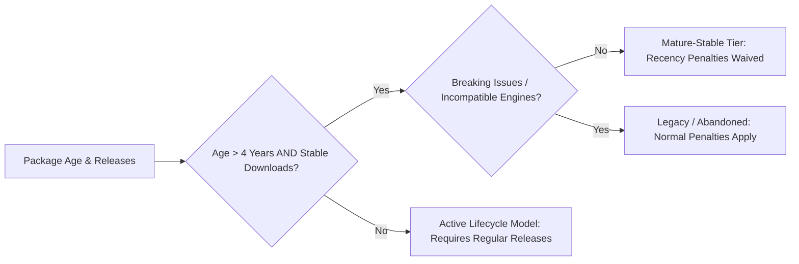

# DepPulse Scoring Methodology (v1.0)

## 1. Core Principles

1. **Deterministic & Rule-Based**: The scoring engine is an inspectable state machine. Given identical telemetry inputs, it generates identical scores and evidence traces every time. No black-box machine learning or stochastic models.
2. **Evidence-First & Explainable**: Every score adjustment is an auditable `HealthEvidence` item with an observed fact, data source, timestamp, and contribution/cap.
3. **Missing Data is NOT Evidence of Poor Health**: An unlinked repository or missing download metric only reduces _confidence_, never deducts health points. If confidence falls below threshold, the score is marked `unknown` (`null`).
4. **Decoupled from Vulnerability Feeds**: Security advisories (CVEs) are reported purely as contextual annotations. A 5-year-old package with 0 CVEs is not automatically well-maintained, and a well-maintained package receiving a zero-day patch is not unmaintained.

---

## 2. Signal Definitions & Measurement

| Signal                             | Primary Source              | Measurement Metric                                                             | Maximum Base Impact | Fatal Cap Rule                       |
| :--------------------------------- | :-------------------------- | :----------------------------------------------------------------------------- | :------------------ | :----------------------------------- |
| **Deprecation**                    | npm packument               | Flag `deprecated` + deprecation message                                        | Deducts 80 points   | Hard Cap: $\max(Score) = 20$         |
| **Repo Archive**                   | GitHub API                  | Flag `archived === true` on verified repo                                      | Deducts 75 points   | Hard Cap: $\max(Score) = 25$         |
| **Release Recency**                | npm versions/time           | Days elapsed since last published version, adjusted by **Package Maturity**    | -30 to +20 points   | None (continuous)                    |
| **Release Cadence**                | npm versions/time           | Standard deviation & frequency of minor/patch releases over previous 24 months | -15 to +15 points   | None (continuous)                    |
| **Engine / Runtime Compatibility** | package.json `engines.node` | Compatibility with current active Node.js LTS versions                         | -25 to +10 points   | If incompatible with all LTS: Cap 40 |
| **Repo Provenance Integrity**      | npm provenance + GitHub     | Match between npm publisher signature and claimed repo                         | -20 to +10 points   | If divergent: Cap 30 (spoofing risk) |
| **Community Health / Issues**      | GitHub API                  | Issue close ratio and responsiveness over 12 months                            | -15 to +15 points   | Evaluated only when repo verified    |

---

## 3. The "Mature Stable" vs. "Dead" Calibration Model

A major flaw in naive maintenance scoring (e.g., standard commit-frequency checks) is penalizing "done" libraries (such as `wrappy`, `once`, `mime-types`, or `is-number`) that solve a discrete problem, have zero open bugs, and require no code changes for years.

DepPulse classifies packages into lifecycle stages:

### Maturity Rules:

1. A package is evaluated for **Mature-Stable Status** if:
   - Initial version published $\ge 4$ years ago.
   - Lifetime release count $\ge 10$ or API surface is documented single-function utility.
   - High adoption or zero open critical bug issues.
2. In the **Mature-Stable Tier**:
   - Lack of releases over 12–24 months incurs **0 penalty** (as long as `engines.node` remains compatible with active LTS).
   - If a package has not seen a release in $>36$ months _and_ declares no `engines` field, a mild warning (-10) is issued instead of a critical abandonment penalty.

---

## 4. Double-Counting Prevention Matrix

Correlated signals (e.g., repository archived + no recent releases + deprecation) can easily create runaway negative penalties exceeding -200 points.

DepPulse eliminates double-counting via **Orthogonal Stratification and Capping**:

1. **Fatal Caps Override Additive Penalties**:
   - If `isDeprecated === true`, the score is immediately bounded by the cap: $\min(\text{accumulatedScore}, 20)$.
   - If `isArchived === true`, the score is bounded by $\min(\text{accumulatedScore}, 25)$.
2. **Normalized Dimension Weights**:
   The base score starts at **100** and moves through four bounded dimensions:
   - **Dimension A: Lifecycle Status** (Deprecation / Archival / De-listing) $\rightarrow$ Caps score [0..25].
   - **Dimension B: Cadence & Recency** $\rightarrow$ Max swing: $[-30, +10]$.
   - **Dimension C: Ecosystem & Runtime Compatibility** $\rightarrow$ Max swing: $[-30, +10]$.
   - **Dimension D: Provenance & Metadata** $\rightarrow$ Max swing: $[-20, +10]$.
3. **Clamping**:
   Final score is strictly clamped to $[0, 100]$.

---

## 5. Confidence Score Computation

Confidence represents the completeness and reliability of gathered telemetry on a scale from $0.0$ to $1.0$:

$$\text{Confidence} = C_{\text{registry}} + C_{\text{repo}} + C_{\text{runtime}} + C_{\text{provenance}}$$

- **$C\_{\text{registry}}$ (0.35)**: Full packument retrieved, valid license, semantic versions parseable, publish timestamps available.
- **$C\_{\text{repo}}$ (0.35)**: Repository URL successfully resolved and **identity verified** (owner/repo matches package scope or npm provenance). If repo is missing or unverified, $C_{\text{repo}} = 0.0$.
- **$C\_{\text{runtime}}$ (0.15)**: `engines.node` field present and verifiable against current Node LTS release matrix.
- **$C\_{\text{provenance}}$ (0.15)**: Cryptographic npm build provenance attestation present.

### The "Unknown" Score Rule:

- If $\text{Confidence} < 0.35$:
  - `score = null`
  - `maintenanceRisk = "unknown"`
  - `explanation = "Insufficient public telemetry to reliably score maintenance health without speculation."`
  - _Missing data is explicitly not a fault of the package._

---

## 6. Risk Thresholds

| Score Range  | Maintenance Risk Level | Actionable Developer Guidance                                                                                                  |
| :----------- | :--------------------- | :----------------------------------------------------------------------------------------------------------------------------- |
| **80 – 100** | `low`                  | Healthy, active or verified mature-stable. Safe for production.                                                                |
| **50 – 79**  | `medium`               | Sluggish maintenance, stale runtime declarations, or slowing release velocity. Monitor.                                        |
| **26 – 49**  | `high`                 | Multi-year release freeze with unaddressed bugs, unverified provenance, or obsolete Node engine compatibility. Plan migration. |
| **0 – 25**   | `critical`             | Deprecated, archived repository, or abandoned. Replace immediately.                                                            |
| `null`       | `unknown`              | Insufficient telemetry (e.g. private unresolvable repo, sparse registry metadata).                                             |

---

## 7. Calibration Suite & Golden Fixtures

To ensure scoring stability across versions, any change to scoring rules must pass the automated regression suite against the following 12 benchmark archetype packages:

| Fixture Package         | Archetype                                    | Expected Risk              | Expected Score Target                 | Validation Purpose                                                  |
| :---------------------- | :------------------------------------------- | :------------------------- | :------------------------------------ | :------------------------------------------------------------------ |
| `typescript`            | Hyper-active enterprise OSS                  | `low`                      | 95 – 100                              | Verifies active multi-maintainer cadence                            |
| `express`               | Maintained foundation tier                   | `low`                      | 82 – 92                               | Verifies slower release cycle on core framework                     |
| `wrappy`                | Mature-stable single-purpose utility         | `low`                      | 80 – 90                               | **Critical**: Must NOT be penalized for lack of recent commits      |
| `mime-types`            | Mature-stable data dictionary                | `low`                      | 80 – 90                               | Verifies infrequent updates are rewarded if compatibility is intact |
| `request`               | Formally deprecated legacy library           | `critical`                 | 0 – 20                                | Verifies fatal deprecation cap                                      |
| `urllib` (v1/v2 legacy) | Abandoned / archived upstream repo           | `critical`                 | 0 – 25                                | Verifies repo archive cap                                           |
| `rimraf` (v3 vs v5)     | Major version upgrade divergence             | `medium` (v3) / `low` (v5) | 60 – 70 (v3)                          | Tests version-specific health scoring                               |
| `spoofed-demo-pkg`      | Malicious metadata claiming `facebook/react` | `high`                     | 20 – 35                               | Verifies unverified repository penalty                              |
| `minimal-no-repo`       | Clean utility with no public git repository  | `unknown` or `medium`      | Score valid only if confidence allows | Tests missing repo confidence handling                              |
